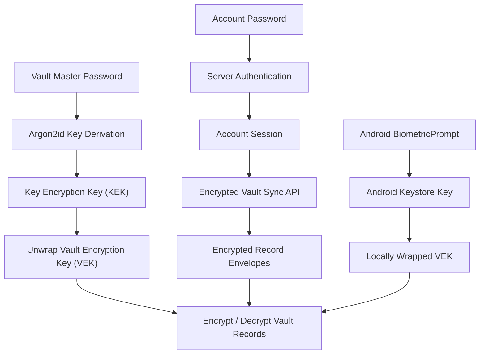

# VaultSync

> **Status:** Under active development — Android biometric unlock implemented; security verification and end-to-end integration remain in progress.

[](https://github.com/vaultsync/vaultsync/actions)
[](LICENSE)
[](https://www.python.org/)
[](https://developer.android.com/)

**VaultSync** is an open-source, self-hosted, end-to-end encrypted personal password manager designed to synchronize credentials between an Android device and a Fedora Linux desktop over a private network such as Tailscale or WireGuard.

The project prioritizes client-side encryption, separation of account authentication from vault encryption, offline access, and user-controlled infrastructure. It is being developed without a dependency on commercial cloud platforms or Docker containers.

> **Security notice:** VaultSync is under active development and has not undergone an independent security audit. Do not use it as the sole storage location for important production credentials. Automated tests and successful builds do not establish that every security property has been independently verified.

---

## Table of Contents

- [Key Features](#key-features)
- [Security Architecture](#security-architecture)
- [Cryptography](#cryptography)
- [Application Architecture](#application-architecture)
- [Repository Structure](#repository-structure)
- [Development Environment](#development-environment)
- [Backend Setup](#backend-setup)
- [Desktop Client](#desktop-client)
- [Android Client](#android-client)
- [Testing](#testing)
- [Network and Deployment](#network-and-deployment)
- [Project Roadmap](#project-roadmap)
- [Security Limitations](#security-limitations)
- [Contributing](#contributing)
- [License](#license)

---

## Key Features

### Security and Cryptography

- **Zero-knowledge design:** Vault contents and the vault master password are intended to remain client-side. The server handles authentication and synchronization of encrypted vault data.
- **Two-credential architecture:** The account password authenticates the user to the backend, while the separate vault master password derives the key-encryption key used to unwrap the vault encryption key.
- **Authenticated encryption:** AES-256-GCM protects encrypted vault data, including authentication against unauthorized ciphertext modification.
- **Memory-conscious lifecycle:** Desktop and Android implementations include lock/logout cleanup paths for sensitive in-memory state.
- **Android biometric unlock:** An Android Keystore-based wrapping design and system `BiometricPrompt` integration provide an alternate local unlock path.
- **Account-bound biometric envelopes:** Biometric-wrapped vault keys use account-specific authenticated associated data.
- **Cross-platform cryptographic specification:** Shared parameters and test vectors help keep the Python and Kotlin implementations interoperable.

### Synchronization and Offline Access

- **Offline-first Android persistence:** Room stores encrypted record envelopes and synchronization state locally.
- **Offline vault access:** The Android client is designed to load locally persisted encrypted records after an authorized unlock.
- **Incremental synchronization:** Version cursors support fetching changes rather than repeatedly downloading the entire vault.
- **Deletion tombstones:** Deletions can be represented and synchronized across devices.
- **Concurrency handling:** The synchronization architecture includes cursor progression, deduplication, and optimistic concurrency handling.
- **Encrypted local record storage:** Record payloads are stored as encrypted envelopes rather than plaintext vault fields.

### Native Clients

- **Fedora Linux desktop:** Python, PySide6, and a native graphical interface, with session-keyring integration and auto-lock functionality.
- **Android mobile:** Kotlin, Jetpack Compose, Android Keystore integration, Room persistence, biometric unlock, and repository/view-model architecture.
- **Self-hosted backend:** FastAPI provides authentication, health endpoints, and vault synchronization APIs.

### Operational Controls

- Database-backed rate limiting designed to support multiple backend workers.
- SHA-256 bearer-token verifier storage, rather than storing raw session tokens in the session-verifier database field.
- Automated backend, desktop, and Android test suites.
- Staging-based Android builds to avoid overwriting the existing debug APK during development.

---

## Security Architecture

VaultSync separates server authentication from vault decryption.



### Credential separation

The two credentials serve different purposes:

| Credential | Purpose | Intended handling |
|---|---|---|
| Account password | Authenticate to the server | Server stores a password verifier; password is not the vault encryption key |
| Vault master password | Derive the KEK used to unwrap the VEK | Remains client-side |
| Vault encryption key (VEK) | Encrypt and decrypt vault records | Kept in memory while the vault is unlocked; wrapped for persistence or transport where required |
| Bearer token | Authenticate API requests | Client session storage; backend stores a SHA-256 verifier hash |

Compromise of the server's account-authentication database should not, by itself, provide the vault master password or the unwrapped VEK.

This separation does not protect against every attack. An attacker who compromises an unlocked client, obtains relevant client-side secrets, or exploits a vulnerability in the cryptographic implementation may still compromise vault contents.

### Android biometric unlock

The Android biometric implementation is intended as an alternative local authorization mechanism, not a replacement for the vault master password.

1. The user unlocks the vault through the normal master-password flow.
2. The user explicitly enables biometric unlock.
3. A local Keystore key protects a wrapped representation of the VEK.
4. On a subsequent unlock, the system biometric prompt authorizes the relevant cryptographic operation.
5. If biometric unlock becomes unavailable or the key is invalidated, the master-password flow remains the recovery path.

The current implementation includes account-bound authenticated data, biometric enrollment settings, and lock/logout lifecycle checks. Physical-device verification of actual biometric and hardware-backed key behavior remains pending.

---

## Cryptography

VaultSync uses established cryptographic primitives rather than a custom encryption algorithm.

| Component | Specification |
|---|---|
| Password-based key derivation | Argon2id |
| Argon2id memory cost | 65,536 KiB |
| Argon2id time cost | 3 iterations |
| Argon2id parallelism | 4 |
| Salt length | 16 bytes |
| Derived key length | 32 bytes |
| Key derivation expansion | HKDF-SHA256 |
| Key wrapping | AES-256-GCM |
| Record encryption | AES-256-GCM |
| GCM nonce | 12 bytes |
| GCM authentication tag | 16 bytes |
| Password normalization | NFC followed by UTF-8 encoding |

The shared cryptographic specification defines domain-separation labels and authenticated associated data for key wrapping and record encryption. Cross-language test vectors are used to help maintain compatibility between the Python and Kotlin implementations.

Changes to these parameters or labels must be treated as protocol changes and reviewed for compatibility and security impact.

See [`docs/cryptography.md`](docs/cryptography.md) and [`shared/test-vectors/`](shared/test-vectors/) for the project's detailed specification and interoperability resources.

---

## Application Architecture

VaultSync consists of three primary components.

### 1. FastAPI backend

The backend provides account authentication, session verification, rate limiting, and encrypted-vault synchronization. It uses SQLAlchemy and Alembic for database persistence and schema migrations.

The backend is not intended to decrypt vault records.

### 2. Fedora desktop client

The desktop client is written in Python using PySide6. It communicates with the backend and supports the project's separate account-password and vault-master-password model.

Desktop development includes session-keyring integration, locking behavior, and encrypted-vault operations.

### 3. Android client

The Android application uses Kotlin and Jetpack Compose. Its data and security components include:

- `BiometricKeyManager` for biometric-protected VEK wrapping.
- `KeyStoreManager` for client-side session-related key and token handling.
- `VaultRepository` for vault operations and synchronization.
- Room entities for encrypted records and synchronization state.
- ViewModels for authentication, settings, and UI state.
- `BiometricPrompt` for system-mediated biometric authentication.

Room provides local persistence for encrypted record envelopes and synchronization metadata. This does **not** establish that the entire Room/SQLite database file is encrypted. Database-level encryption and metadata protection must be evaluated separately.

---

## Repository Structure

```text
vaultsync/
├── README.md
├── SECURITY.md
├── CONTRIBUTING.md
├── LICENSE
├── .gitignore
├── docs/
│   ├── architecture.md
│   ├── threat-model.md
│   ├── cryptography.md
│   ├── api-spec.md
│   ├── recovery.md
│   └── decisions/
├── server/
│   ├── alembic.ini
│   ├── alembic/
│   ├── pyproject.toml
│   ├── src/
│   │   └── vaultsync_server/
│   └── tests/
├── desktop/
│   ├── pyproject.toml
│   ├── src/
│   │   └── vaultsync_desktop/
│   └── tests/
├── android/
│   ├── settings.gradle.kts
│   └── app/
│       └── src/
├── shared/
│   ├── api-schema/
│   └── test-vectors/
└── .github/
    └── workflows/
        └── tests.yml
```

The tree above is a high-level overview. Individual files and directories may evolve during development.

---

## Development Environment

### Prerequisites

- Fedora Linux or another supported Linux distribution.
- Python 3.12 or newer for the backend and desktop components.
- Git.
- OpenJDK 17 for the current Android Gradle build configuration.
- Android SDK with the project's configured Android platform and build tools.
- Android Studio or another Kotlin/Gradle-compatible development environment is optional, but may help with Android debugging.

VaultSync does not require Docker for the intended development workflow.

### Python environment

From the repository root:

```bash
python3 -m venv .venv
source .venv/bin/activate
```

Install the backend and desktop packages using their respective project configuration:

```bash
pip install -e "server[dev]"
pip install -e "desktop[dev]"
```

If an editable install or extra name changes, follow the current package metadata in the relevant `pyproject.toml`.

---

## Backend Setup

### Database migrations

Apply the backend's Alembic migrations to the configured **development database**:

```bash
alembic -c server/alembic.ini upgrade head
```

**Important:** Verify the configured database URL before running migrations. Never point development or test migrations at a database containing important data.

### Run backend tests

```bash
.venv/bin/pytest server/tests -v
```

### Start the local server

```bash
.venv/bin/python -m uvicorn vaultsync_server.main:app \
  --host 127.0.0.1 \
  --port 8000
```

Verify the health endpoint:

```bash
curl -s http://127.0.0.1:8000/health
```

The local loopback configuration is intended for development. It is not, by itself, a remote deployment configuration.

### Administrative account recovery

The project includes an administrative account-reset utility. Before using it, review its help output and verify the database configuration so it cannot affect an unintended account or database.

```bash
python -m vaultsync_server.scripts.admin_reset --help
```

Avoid putting real passwords in shell history, command-line arguments, logs, or shared terminals. Prefer a supported interactive prompt over piping secrets into a process.

---

## Desktop Client

Install the desktop package:

```bash
pip install -e "desktop[dev]"
```

Launch it against the local backend:

```bash
vaultsync-desktop --server http://127.0.0.1:8000
```

Run desktop tests in a headless environment:

```bash
QT_QPA_PLATFORM=offscreen .venv/bin/pytest desktop/tests -v
```

Desktop session-keyring and memory-cleanup behavior should be tested in the actual target desktop environment in addition to automated tests.

---

## Android Client

The Android application is built with Kotlin, Jetpack Compose, Android Keystore, BiometricPrompt, and Room.

### Current implementation

- Native authentication and unlock flows.
- Master-password-based vault unlock.
- Locally persisted encrypted record envelopes.
- Offline record loading and local persistence.
- Incremental synchronization and tombstone handling.
- Biometric-protected local VEK wrapping.
- Lock/logout cleanup and stale-operation fencing.
- Automated JVM and Robolectric tests.

### Build and test

Use the JDK and Android SDK versions configured for the project. From the Android project directory, run the Gradle wrapper for unit tests and debug assembly.

```bash
./gradlew testDebugUnitTest --no-daemon --max-workers=2
./gradlew assembleDebug --no-daemon --max-workers=2
```

These commands assume the correct Java and Android SDK environment variables have been configured.

For safer development, direct experimental builds to an isolated staging directory and preserve existing APKs until a new build has been validated.

**Testing limitation:** JVM/Robolectric tests do not substitute for testing on a physical Android device. Actual biometric prompts, Keystore security levels, enrollment changes, and hardware-backed key behavior require device-level verification.

Android Autofill integration is a planned milestone and should not be considered production-ready until its implementation and security tests are complete.

---

## Testing

VaultSync uses automated tests to catch regressions across the backend, desktop, and Android clients.

### Backend

```bash
.venv/bin/pytest server/tests -v
```

### Desktop

```bash
QT_QPA_PLATFORM=offscreen .venv/bin/pytest desktop/tests -v
```

### Android

```bash
./gradlew testDebugUnitTest --no-daemon --max-workers=2
```

### Reported validation snapshot

The Phase 8.1 development report recorded the following results:

| Component | Reported tests passed |
|---|---:|
| Backend | 65 |
| Desktop | 80 |
| Android JVM/Robolectric | 84 |
| **Total** | **229** |

These are the results reported for that development run, not a guarantee that the current checkout or latest commit has the same test counts. Re-run the tests against the source you intend to use.

A successful automated suite does not establish resistance to all attacks, and the Android biometric suite has not yet been validated on physical biometric hardware.

---

## Network and Deployment

VaultSync is designed for self-hosted use. A private overlay such as Tailscale or WireGuard can provide connectivity between trusted devices without requiring a publicly exposed application endpoint.

The intended deployment model is:

1. Run the backend on a trusted Linux host.
2. Configure a private VPN or mesh network between the host and clients.
3. Restrict backend reachability to trusted interfaces and peers.
4. Use appropriate transport security for the actual network and deployment configuration.
5. Back up the server database and required recovery material securely.
6. Verify restore procedures using isolated test data.
7. Monitor service health and keep dependencies updated.

Binding the development server to `127.0.0.1` makes it reachable only through the host's loopback interface. A remote client cannot reach that endpoint directly. Remote deployment requires a deliberate, reviewed networking configuration.

Tailscale and WireGuard provide network connectivity; they do not replace application authentication, endpoint hardening, or a complete transport-security design.

Systemd hardening, end-to-end VPN synchronization, and backup/restore verification remain integration tasks.

---

## Project Roadmap

The project has progressed beyond the initial backend and desktop milestones. The roadmap below distinguishes implemented development work from remaining verification.

- [x] **Phase 1 — Foundation:** Repository structure, backend health API, CI foundation, and architecture documentation.
- [x] **Phase 2 — Cryptographic Prototype:** Argon2id derivation, authenticated encryption, key wrapping, and cross-language test vectors.
- [x] **Phase 3 — Backend Synchronization:** Database persistence, migrations, sessions, synchronization, and tombstones.
- [x] **Phase 3.1 — Security Review:** Credential-separation analysis, rate limiting, and synchronization transaction tests.
- [x] **Phase 3.2 — Two-Credential Architecture:** Separate account authentication from vault encryption and add migration/recovery support.
- [x] **Phase 4 — Fedora Desktop Client:** PySide6 application, session-keyring integration, and core vault workflows.
- [x] **Phase 5 — Android Foundation:** Native Kotlin/Compose client and cryptographic integration.
- [x] **Phase 6 — Android Offline Persistence:** Room-backed encrypted record storage and offline-first repository behavior.
- [x] **Phase 7 — Android Synchronization and Hardening:** Incremental sync, persistence regression testing, and lifecycle handling.
- [x] **Phase 8.0 — Offline Persistence:** Local encrypted record envelopes, synchronization state, and offline reload workflows.
- [x] **Phase 8.1 — Biometric Unlock Implementation:** Android Keystore-based VEK wrapping, BiometricPrompt integration, account-bound AAD, and automated tests.
- [ ] **Phase 8.1.1 — Biometric Security Verification:** Audit key invalidation semantics, hardware-backed key claims, account isolation, and lifecycle races; fix any verified issues.
- [ ] **Phase 8.2 — Android Autofill:** Secure AutofillService integration, user consent, and authentication-gated credential filling.
- [ ] **Phase 9 — End-to-End Integration:** Verify synchronization between Android and Fedora over Tailscale/WireGuard.
- [ ] **Phase 10 — Deployment and Recovery Hardening:** systemd restrictions, backup/restore drills, operational documentation, and security review.
- [ ] **Release Readiness:** Device-level testing, threat-model review, dependency review, and independent security assessment.

Roadmap checkmarks describe implementation milestones, not a certification that the project is secure for production use.

---

## Security Limitations

VaultSync is a security-sensitive project. The following areas require particular care:

- **No independent security audit:** The design and implementation have not been independently certified.
- **Android hardware backing:** Actual TEE/StrongBox use and biometric behavior have not yet been verified on physical hardware.
- **SQLite database encryption:** Encrypted record payloads do not establish that all database metadata, indexes, or other SQLite contents are encrypted.
- **Endpoint compromise:** Malware, a compromised operating system, or an attacker controlling an unlocked device may be able to access credentials.
- **Memory handling:** Applications can reduce the lifetime of sensitive data in memory, but Kotlin/JVM and Python runtimes cannot guarantee complete memory zeroization for all object copies.
- **Network deployment:** Private VPN connectivity is not a substitute for a reviewed application and transport-security configuration.
- **Recovery and backups:** Recovery workflows must be tested without exposing master passwords or unwrapped keys.

Review [`SECURITY.md`](SECURITY.md) and [`docs/threat-model.md`](docs/threat-model.md) before evaluating VaultSync for sensitive use.

If you discover a security vulnerability, follow the project's security reporting policy rather than publishing exploit details alongside sensitive user data.

---

## Contributing

Contributions should preserve the project's cryptographic protocol and security invariants.

Before proposing changes:

1. Read the architecture and threat-model documentation.
2. Avoid logging secrets or adding plaintext credential storage.
3. Use isolated databases and synthetic credentials for tests.
4. Add regression tests for security-sensitive behavior.
5. Document protocol changes and compatibility implications.
6. Run the relevant automated test suites.

See [`CONTRIBUTING.md`](CONTRIBUTING.md) for contribution guidelines.

---

## License

VaultSync is distributed under the MIT License. See [`LICENSE`](LICENSE).
