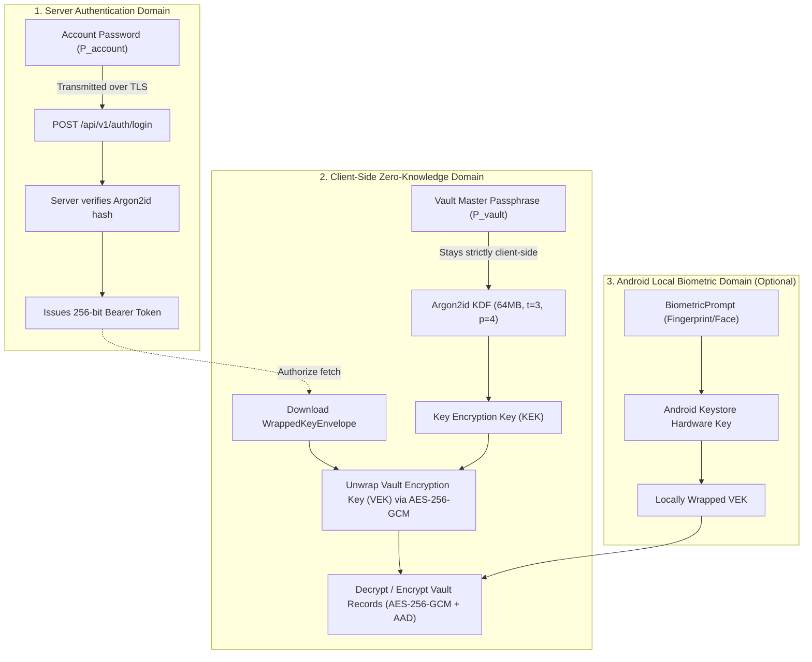
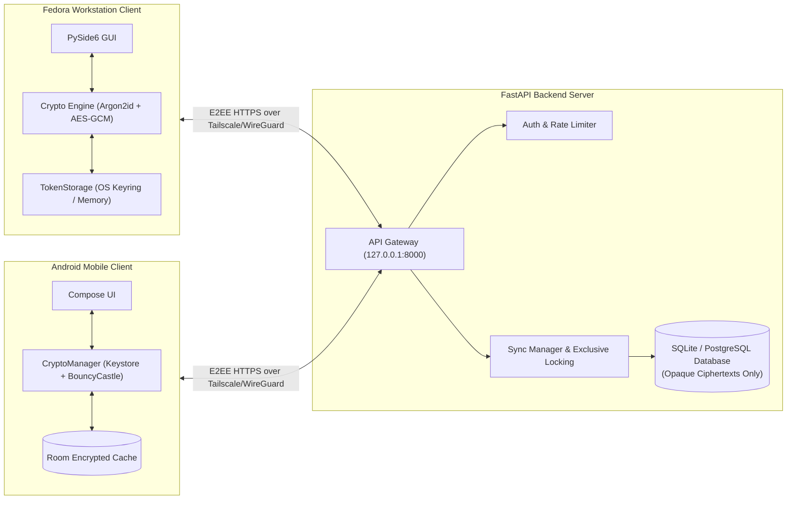

# VaultSync

## VaultSync v0.9.0-beta.1

> **Status:** Release Preparation (Phase 8.6) — Backend and desktop test suites fully passing (160/160 tests, 100%); Android ANR remediation implemented and staging APK verified; physical-device Android validation explicitly deferred.

[](https://github.com/vaultsync/vaultsync/actions)
[](LICENSE)
[](https://www.python.org/)
[](https://developer.android.com/)

**VaultSync** is an open-source, self-hosted, end-to-end encrypted personal password management ecosystem designed to synchronize credentials between an Android mobile device and a Fedora Linux desktop workstation over a private network (such as Tailscale or WireGuard).

The project prioritizes client-side zero-knowledge encryption, strict separation of account authentication from vault encryption, offline access, and user-controlled infrastructure without dependencies on commercial cloud platforms or proprietary services.

> [!WARNING]
> **Security Notice:**
> VaultSync is under active development and has not undergone an independent third-party security audit. Do not use it as the sole storage location for critical production credentials. Automated test execution and build passing do not substitute for physical device testing or an independent cryptographic audit.

---

## Table of Contents

- [Key Features](#key-features)
- [Current Development Status](#current-development-status)
- [Security Architecture & Two-Credential Model](#security-architecture--two-credential-model)
- [Zero-Knowledge Model & Cryptography](#zero-knowledge-model--cryptography)
- [Application Architecture](#application-architecture)
- [Repository Structure](#repository-structure)
- [Development Environment & Prerequisites](#development-environment--prerequisites)
- [Backend Setup & Safe Execution](#backend-setup--safe-execution)
- [Desktop Client Setup](#desktop-client-setup)
- [Android Client Setup](#android-client-setup)
- [Automated Testing](#automated-testing)
- [Network & Deployment Guide](#network--deployment-guide)
- [Operational Runbooks & Backup](#operational-runbooks--backup)
- [Release Checklist & Verification Tiers](#release-checklist--verification-tiers)
- [Known Limitations](#known-limitations)
- [Contributing](#contributing)
- [License](#license)

---

## Current Development Status

The VaultSync project has completed Phase 8.5 (Non-Android Security, Integration & Release Readiness) and Phase 8.6 (Complete Release Preparation).

| Subsystem / Milestone | Current Status | Verification Tier |
|---|---|---|
| **Backend Core & REST API** | Implemented & Remediated | 80/80 automated tests passing |
| **Atomic Sync Cursor Concurrency (SEC-01)** | Implemented (`exclusive_transaction`) | Verified under concurrent worker tests |
| **Synthetic Salt & Anti-Enumeration (SEC-02)** | Implemented (HMAC-SHA256) | Verified with timing & parameter tests |
| **Auth Rate Limiting & IPv6 Normalization** | Implemented (`auth_rate_limits` table) | Verified with compound index tests |
| **Production Config Fail-Closed Validation** | Implemented (`config.py`) | Verified via Pydantic model validation |
| **Fedora Desktop Client (PySide6)** | Implemented & Hardened | 80/80 automated tests passing |
| **Client Memory Zeroization** | Implemented (`clear_key_material`) | Verified via buffer zeroing tests |
| **Cross-Platform Crypto Interoperability** | Implemented (AES-256-GCM + AAD) | Verified across shared test vectors |
| **Android ANR Remediation (Phase 8.2.3)** | Implemented in coroutines & staging APK | Verified statically & via staging APK audit |
| **Android Physical-Device Testing** | **Explicitly Deferred** | Pending physical hardware test phase |
| **Total Automated Test Suite** | **160 / 160 Passing (100%)** | Backend (80) + Desktop (80) |

---

## Key Features

### Security and Cryptography
- **Zero-knowledge architecture:** The server receives and persists only opaque AES-256-GCM encrypted envelopes, wrapped keys, and public salts. Plaintext credentials, notes, URLs, and master passphrases never touch the network or the server.
- **Two-credential isolation:** Independent Account Password (authenticates to server) and Vault Master Passphrase (unwraps vault key locally). Changing one has zero cryptographic effect on the other.
- **Associated Authenticated Data (AAD):** Every record envelope binds the item's unique `record_id` as AAD, preventing ciphertext swapping, envelope relocation, and replay attacks.
- **Memory hygiene:** `clear_key_material()` actively zeroes `bytearray` memory buffers upon vault lock, logout, or account switching.
- **Sliding-window abuse control:** Sliding-window rate limiting on authentication routes with IPv6 `/64` prefix aggregation to thwart rotating IPv6 credential stuffing.

### Client Usability
- **Fedora Workstation Client:** Native Qt GUI (PySide6), dark theme, real-time search filtering, clipboard auto-clearing (30s) with content verification, inactivity auto-lock, and password entropy evaluation.
- **Android Client:** Modern Jetpack Compose UI, Room encrypted envelope persistence, background synchronization, and Android Keystore integration for biometric authorization.
- **Conflict Handling:** Optimistic concurrency control via monotonic integer versions; detects remote edits and prompts user to resolve conflicts safely.

---

## Final Project Status

| Area | Result | Status |
|---|---|---|
| **Backend and desktop** | 80 backend tests + 80 desktop tests reported passing | **Passed** |
| **Local end-to-end integration** | 10 workflows reported passing over loopback TCP | **Passed** |
| **Protected artifact integrity** | All three SHA-256 checks reportedly match their baselines | **Matched** |
| **Android hardware validation** | Biometrics, StrongBox, Autofill and background sync | **Deferred** |
| **Operational deployment** | TLS reverse proxy and deployed backup-recovery drills | **Deferred** |

## Security Architecture & Two-Credential Model

VaultSync strictly separates server authentication from vault encryption.



### Credential Separation Matrix

| Property | Account Password ($P_{\text{account}}$) | Vault Master Passphrase ($P_{\text{vault}}$) |
|---|---|---|
| **Primary Purpose** | Authenticate identity to the backend API | Derive KEK to unwrap the local Vault Encryption Key |
| **Network Exposure** | Transmitted over TLS to `/api/v1/auth/login` | **Never transmitted across the network** |
| **Server Storage** | Argon2id verifier (`account_password_hash`) | **Zero knowledge (not stored anywhere on server)** |
| **Effect of Compromise** | Attacker obtains bearer token and encrypted blobs | **Attacker can decrypt all vault records** |
| **Administrative Reset** | Reset via server CLI (`admin_reset.py`) | **Mathematically impossible to reset without data loss** |
| **Rotation Procedure** | `POST /api/v1/auth/password` | Re-wraps VEK with new KEK via `PUT /api/v1/auth/vault-key` |

---

## Zero-Knowledge Model & Cryptography

All cryptographic operations strictly adhere to standardized, audited primitives:

| Component | Specification / Primitive | Parameters / Details |
|---|---|---|
| **Key Derivation (KDF)** | Argon2id | Memory: 65,536 KiB (64 MiB), Iterations: 3, Parallelism: 4 |
| **KDF Salt** | Cryptographic Random Salt | 16 bytes (128 bits entropy), per-user unique |
| **Key Derivation Expansion** | HKDF-SHA256 | Expands Argon2id output to 256-bit key |
| **Key Wrapping** | AES-256-GCM | 96-bit random nonce, 128-bit authentication tag |
| **Record Encryption** | AES-256-GCM | 96-bit random nonce, 128-bit authentication tag |
| **Authenticated Data (AAD)**| UTF-8 string | Binds `record_id` as AAD to prevent record swapping |
| **Server Token Hashing** | SHA-256 | Bearer tokens hashed before storage in database |
| **Synthetic Salt Derivation**| HMAC-SHA256 | `hmac(server_secret_key, username)[:16]` |

---

## Application Architecture



---

## Repository Structure

```text
vaultsync/
├── README.md                      # Comprehensive project overview & setup guide
├── SECURITY.md                    # Vulnerability reporting policy & disclosures
├── CONTRIBUTING.md                # Development & code standards
├── LICENSE                        # MIT License
├── .env.example                   # Documented configuration template
├── docs/
│   ├── architecture.md            # System architecture & data flow
│   ├── cryptography.md            # Cryptographic specification & parameters
│   ├── SECURITY_AND_DEPLOYMENT.md # Production deployment, reverse proxy, HSTS, secrets
│   ├── recovery.md                # Database backup, restore drills, disaster recovery
│   ├── RELEASE_CHECKLIST.md       # Multi-tier verification & readiness checklist
│   ├── threat-model.md            # Threat model & attack surfaces
│   ├── api-spec.md                # REST API endpoint specification
│   └── decisions/                 # Architectural Decision Records (ADRs)
├── server/
│   ├── pyproject.toml             # Backend dependencies & pytest configuration
│   ├── alembic.ini                # Alembic database migration config
│   ├── alembic/                   # Database migration versions
│   ├── src/vaultsync_server/      # FastAPI application code
│   └── tests/                     # 80 backend automated tests
├── desktop/
│   ├── pyproject.toml             # Desktop dependencies & packaging
│   ├── src/vaultsync_desktop/     # PySide6 application code
│   └── tests/                     # 80 desktop automated tests
├── android/
│   ├── build.gradle.kts           # Top-level Gradle configuration (AGP 8.5.2, Kotlin 2.0.0)
│   ├── settings.gradle.kts        # Android module declarations
│   └── app/                       # Android application module
└── shared/
    ├── api-schema/                # OpenAPI specification & schemas
    └── test-vectors/              # Cross-language golden test vectors & specs
```

---

## Development Environment & Prerequisites

### Prerequisites
- **Operating System:** Fedora Linux 39+ (Workstation/GNOME or Hyprland) or equivalent Linux distribution.
- **Python:** Python 3.12 or newer (tested through Python 3.14.8).
- **System Libraries (Fedora):**
  ```bash
  sudo dnf install -y python3-devel libxcb xcb-util-cursor sqlite
  ```
- **Java Runtime (for Android):** OpenJDK 17 (`java-17-openjdk-devel`).
- **Android SDK:** Android SDK Platform 34, Build Tools 34.0.0.

### Environment Setup
From the repository root:

```bash
# 1. Create and activate virtual environment
python3 -m venv .venv
source .venv/bin/activate

# 2. Install backend package with development extras
pip install -e "server[dev]"

# 3. Install desktop package with development extras
pip install -e "desktop[dev]"
```

---

## Backend Setup & Safe Execution

### 1. Configuration
Copy the configuration template:
```bash
cp .env.example .env
```
Inspect `.env`. For local development, safe defaults bind to `127.0.0.1:8000` and target `sqlite:///./vaultsync_dev.db`.

> [!NOTE]
> The backend defaults to `vaultsync_dev.db`. It will never touch the protected baseline database `vaultsync.db`. In production, pointing to `vaultsync.db` is rejected at startup.

### 2. Database Migrations
Apply Alembic migrations to initialize the development database:
```bash
alembic -c server/alembic.ini upgrade head
```

### 3. Start Local Development Server
```bash
.venv/bin/python -m uvicorn vaultsync_server.main:app \
  --host 127.0.0.1 \
  --port 8000 \
  --reload
```

Verify service health:
```bash
curl -s http://127.0.0.1:8000/health
# Expected: {"status":"healthy","version":"0.9.0-beta.1","environment":"development"}
```

### 4. Administrative Account Reset Utility
If an account password is forgotten during local testing:
```bash
.venv/bin/python -m vaultsync_server.scripts.admin_reset --username alice
```

---

## Desktop Client Setup

### 1. Launch Against Local Server
With the backend running on `http://127.0.0.1:8000`:
```bash
# Using installed entrypoint
vaultsync-desktop --server http://127.0.0.1:8000

# Or via Python module
python -m vaultsync_desktop.main --server http://127.0.0.1:8000
```

### 2. Supported CLI Options
- `--server <URL>`: Pre-configure backend server URL (`http://127.0.0.1:*`, `http://localhost:*`, or `https://*`).
- `--debug`: Enable verbose diagnostic logging to stdout.

---

## Android Client Setup

The Android mobile client is located in `android/`.

### Build & Unit Testing
```bash
cd android
./gradlew testDebugUnitTest --no-daemon --max-workers=2
```

> [!IMPORTANT]
> **Android Testing Scope Notice:**
> Physical Android device testing and live biometric sensor validation are explicitly deferred. Do not connect physical devices or execute ADB installation commands during automated testing phases.

---

## Automated Testing

VaultSync maintains a comprehensive test suite covering API endpoints, cryptographic boundaries, concurrent synchronization, and headless UI flows.

### Running Backend Tests (80 Tests)
```bash
.venv/bin/pytest server/tests -v
```

### Running Desktop Tests (80 Tests)
```bash
QT_QPA_PLATFORM=offscreen .venv/bin/pytest desktop/tests -v
```

### Running Full Combined Suite (160 Tests)
```bash
QT_QPA_PLATFORM=offscreen .venv/bin/pytest --import-mode=importlib server/tests desktop/tests -v
```

### Test Suite Execution Summary

| Test Module | Subsystem Focus | Test Count | Status |
|---|---|:---:|:---:|
| `server/tests/test_backend.py` | Core API & Registration | 8 | PASSED |
| `server/tests/test_crypto.py` | Server KDF & Hashes | 22 | PASSED |
| `server/tests/test_health.py` | Health Check Endpoints | 3 | PASSED |
| `server/tests/test_remediation_phase8_4_2.py` | Cursor Atomicity & Production Secrets | 8 | PASSED |
| `server/tests/test_remediation_phase8_4_3.py` | Rate Limiter & Token Revocation | 7 | PASSED |
| `server/tests/test_security_audit_phase5.py` | Security Boundaries & Headers | 13 | PASSED |
| `server/tests/test_security_review.py` | Tenant Isolation & Authorization | 4 | PASSED |
| `server/tests/test_two_credentials.py` | Two-Credential Lifecycle & Isolation | 15 | PASSED |
| **Backend Subtotal** | **FastAPI Server** | **80** | **PASSED (100%)** |
| `desktop/tests/test_client_crypto.py` | Desktop Crypto & Vectors | 7 | PASSED |
| `desktop/tests/test_cross_platform_android_interop.py` | Cross-Platform Interop | 8 | PASSED |
| `desktop/tests/test_desktop_security_phase5.py` | Memory Zeroization & Token Eviction | 8 | PASSED |
| `desktop/tests/test_desktop_usability_phase6.py` | Usability Flows & Conflicts | 13 | PASSED |
| `desktop/tests/test_integration_backend.py` | Client <-> Live Backend Integration | 13 | PASSED |
| `desktop/tests/test_ui_screens.py` | Headless PySide6 Screens & Navigation | 19 | PASSED |
| `desktop/tests/test_vault_session.py` | Session Lifecycle & Synchronization | 9 | PASSED |
| `desktop/tests/test_api_client.py` | HTTP Client & Error Handling | 3 | PASSED |
| **Desktop Subtotal** | **PySide6 Client** | **80** | **PASSED (100%)** |
| **GRAND TOTAL** | **Combined Test Suite** | **160** | **PASSED (100%)** |

---

## Network & Deployment Guide

For full production deployment instructions, review [`docs/SECURITY_AND_DEPLOYMENT.md`](docs/SECURITY_AND_DEPLOYMENT.md).

1. **Private Mesh Overlay:** VaultSync is designed to operate over private encrypted networks such as Tailscale or WireGuard.
2. **Reverse Proxy Requirement:** In production, run the backend behind an authenticated TLS reverse proxy (Nginx or Caddy) that forwards `X-Forwarded-Proto: https`.
3. **Secret Configuration:** Generate a persistent 64-character random hex secret (`openssl rand -hex 32`) and inject via `VAULTSYNC_SERVER_SECRET_KEY`.

---

## Operational Runbooks & Backup

For backup, restoration, and disaster recovery procedures, consult [`docs/recovery.md`](docs/recovery.md):
- **Consistent Backups:** Use `sqlite3 live.db ".backup 'backup.db'"` to ensure point-in-time consistency across WAL journal frames.
- **Encryption at Rest:** Protect backup archives with GPG or Age before offsite storage.
- **Verification Drills:** Always restore backups into an isolated temporary directory and verify with `PRAGMA integrity_check;` before updating production instances.

---

## Release Checklist & Verification Tiers

Detailed multi-tier release readiness tracking is maintained in [`docs/RELEASE_CHECKLIST.md`](docs/RELEASE_CHECKLIST.md):
- **Tier 1 (Automated Tests):** 160/160 passing.
- **Tier 2 (Static Review):** API schemas, Android security config, and dependency manifests verified.
- **Tier 3 (Deployment Testing):** Reverse proxy TLS termination, systemd service units, and backup restoration drills pending operational staging.
- **Tier 4 (Physical Android Testing):** Physical biometric prompt, StrongBox hardware backing, and Android Autofill integration pending physical device testing.

---

## Known Limitations

1. **Physical Android Validation Deferred:** The Android staging APK has passed ANR code remediation and static inspection, but has not yet been verified on a physical Android device with hardware biometrics or StrongBox TEE.
2. **Managed Runtime Memory Zeroization:** While `clear_key_material()` actively zeroes mutable key buffers, Python and JVM managed runtimes cannot guarantee that transient immutable strings (`str`, `java.lang.String`) are zeroized immediately prior to garbage collection. Full disk encryption (LUKS / Android FDE) and memory protections are recommended.
3. **Reverse Proxy Dependency:** The internal ASGI server does not include built-in TLS termination or slow-client defense and requires an external reverse proxy in production.
4. **Irrecoverable Master Password:** VaultSync does not implement recovery phrases or administrative master-password backdoors. Loss of the Vault Master Passphrase results in permanent, unrecoverable data loss.

---

## Contributing

Contributions are welcome! Please read [`CONTRIBUTING.md`](CONTRIBUTING.md) and [`SECURITY.md`](SECURITY.md) before submitting pull requests.

---

## License

VaultSync is distributed under the terms of the MIT License. See [`LICENSE`](LICENSE) for details.
