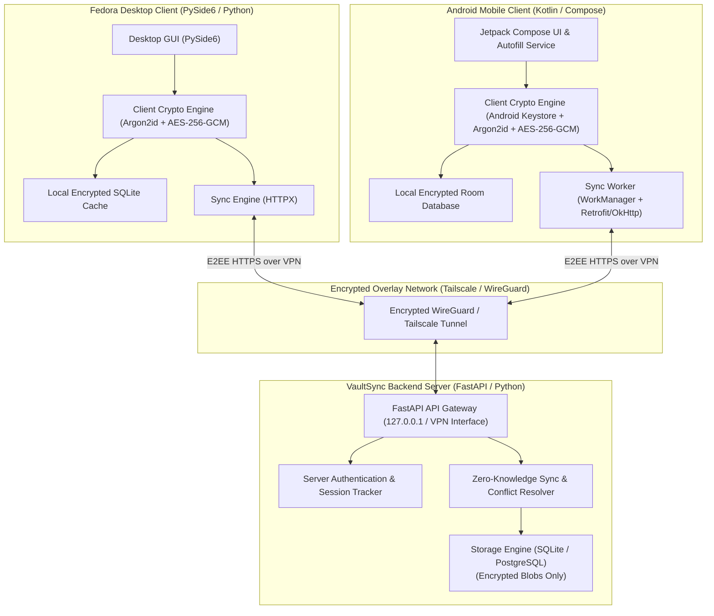

# VaultSync Architecture

VaultSync is a self-hosted, end-to-end encrypted password management ecosystem built for seamless, private synchronization between an Android mobile device and a Fedora Linux desktop workstation over a private VPN mesh (Tailscale or WireGuard).

## Core Architectural Pillars

### 1. Zero-Knowledge Cryptographic Model
The backend synchronization server operates strictly on a **zero-knowledge principle**:
- **Master Password**: Never transmitted across the network under any circumstance.
- **Vault Encryption Key (VEK)**: A 256-bit symmetric key generated randomly on client initialization. The VEK encrypts all vault items.
- **Key-Encryption Key (KEK)**: Derived locally from the master password using Argon2id with a unique per-user salt. The KEK wraps (encrypts) the VEK using authenticated encryption (AES-256-GCM / XChaCha20-Poly1305).
- **Server Storage**: The server stores only the user's salt, the wrapped VEK ciphertext, and encrypted record payloads.

### 2. Private Network Mesh Transport
Rather than exposing the sync API to the public internet or relying on commercial third-party cloud hosting:
- The server binds locally to loopback or a virtual network interface (WireGuard / Tailscale IP).
- Device-to-device communication traverses an authenticated, encrypted VPN mesh.
- Host firewall rules (`nftables`/`firewalld`) enforce isolation, permitting traffic exclusively through the VPN interface.

### 3. Offline-First Synchronization & Conflict Resolution
Clients maintain an active local replica of encrypted items:
- Full offline read and write capabilities.
- Local mutations append to an offline change log.
- Upon connectivity restoration, sync workers exchange changes using **version cursors** and **tombstones** for deleted records.
- If two devices modify the same record concurrently, deterministic conflict detection creates a conflict branch or prompts the user, preventing silent data loss.

### 4. Cross-Platform Interoperability
- A canonical, versioned record schema and wire protocol ensure perfect cryptographic parity between Python (desktop) and Kotlin (Android).
- Standardized test vectors guarantee that records encrypted on Android can be decrypted on Linux and vice versa.
