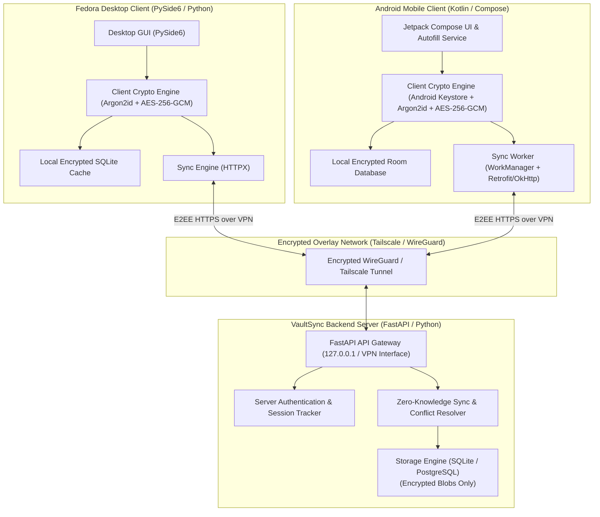
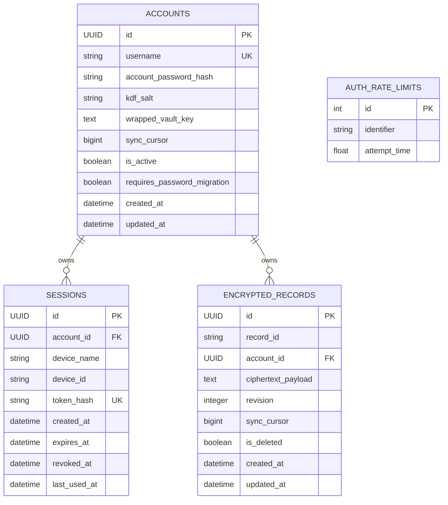

# VaultSync Architecture

VaultSync is a self-hosted, end-to-end encrypted password management ecosystem built for seamless, private synchronization between an Android mobile device and a Fedora Linux desktop workstation over a private VPN mesh (Tailscale or WireGuard).

---

## Core Architectural Pillars

### 1. Zero-Knowledge Cryptographic Model & Two-Credential Architecture
The backend synchronization server operates strictly on a **zero-knowledge principle** with complete credential separation:
- **Account Password ($P_{\text{account}}$)**: Sent over TLS to authenticate against the server API; verified against a server-side Argon2id hash (`account_password_hash`). Never used in vault key derivation.
- **Vault Master Password ($P_{\text{vault}}$)**: Exists strictly on client devices and is **never** transmitted across the network under any circumstance.
- **Vault Encryption Key (VEK)**: A 256-bit symmetric key generated randomly on client initialization. The VEK encrypts all vault items.
- **Key-Encryption Key (KEK)**: Derived locally from the master password using Argon2id ($64\text{ MiB}, t=3, p=4$) with a unique per-user salt. The KEK wraps (encrypts) the VEK using authenticated encryption (AES-256-GCM).
- **Server Storage**: The server stores only the user's public salt, the wrapped VEK ciphertext (`WrappedKeyEnvelope`), and opaque encrypted record payloads.

### 2. Private Network Mesh Transport
Rather than exposing the sync API to the public internet or relying on commercial third-party cloud hosting:
- The server binds locally to loopback or a virtual network interface (WireGuard / Tailscale IP).
- Device-to-device communication traverses an authenticated, encrypted VPN mesh.
- Host firewall rules (`nftables`/`firewalld`) enforce isolation, permitting traffic exclusively through the VPN interface.

### 3. Offline-First Synchronization & Conflict Resolution
Clients maintain an active local replica of encrypted items:
- Full offline read and write capabilities.
- Local mutations append to an offline change log.
- Upon connectivity restoration, sync workers exchange changes using **version cursors** and **tombstones** for deleted records.
- If two devices modify the same record concurrently, deterministic conflict detection creates a conflict branch or prompts the user, preventing silent data loss.

### 4. Cross-Platform Interoperability
- A canonical, versioned record schema and wire protocol ensure perfect cryptographic parity between Python (desktop) and Kotlin (Android).
- Standardized test vectors guarantee that records encrypted on Android can be decrypted on Linux and vice versa.

---

## Backend Persistence and Database Architecture (Phase 3.2)

The backend persistence layer is built with **SQLAlchemy 2.0** and versioned using **Alembic** migrations. It supports SQLite for local development and can be pointed to PostgreSQL in multi-user deployments.

### 1. Account Entity (`accounts`)
- Stores account identity, the server-side Argon2id hash of `account_password`, the public KDF salt, and the wrapped vault key envelope.
- Manages an account-level monotonic `sync_cursor` incremented on every record mutation.
- Tracks `requires_password_migration` flag for legacy accounts.

### 2. Session Entity (`sessions`)
- Represents an active device session.
- **Security Control**: Only stores `token_hash = SHA-256(raw_bearer_token)`. The plaintext token exists only on the client device.
- Validates expiration (`expires_at`) and revocation (`revoked_at`) on every request.

### 3. Encrypted Records Entity (`encrypted_records`)
- Stores client-encrypted `EncryptedRecordEnvelope` JSON blobs.
- Enforces multi-tenant isolation via compound unique constraint `(account_id, record_id)`.
- **Optimistic Concurrency**: Tracks per-record monotonic `revision`. Updates require matching `expected_revision`.
- **Tombstones**: Record deletions set `is_deleted = true`, purge `ciphertext_payload = ""`, and increment `revision` and `sync_cursor`.
